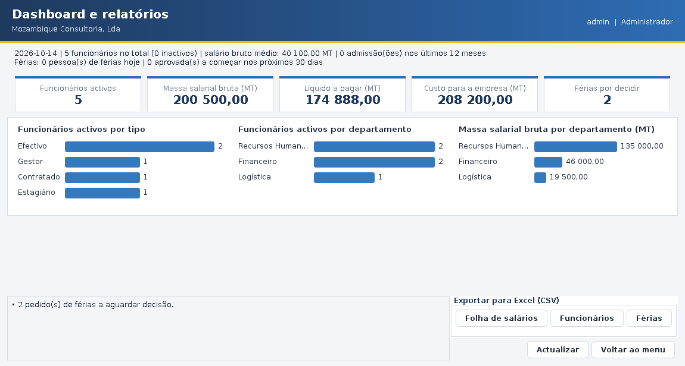

# Gestão de Recursos Humanos — empresas privadas moçambicanas

Aplicação de ambiente de trabalho (Java Swing) para gerir funcionários, departamentos, férias e folha de
salários de uma empresa privada em Moçambique, **seguindo a Lei do Trabalho (Lei n.º 13/2023), o INSS e o IRPS**.



## O que faz

| Área | Funcionalidades |
|---|---|
| **Funcionários** | Admitir, editar, demitir/reactivar e remover; 4 tipos (efectivo, gestor, contratado à hora, estagiário); validação de BI, NUIT, telefone, idade mínima e salário mínimo |
| **Departamentos** | Criar, editar e remover (não remove se ainda tiver pessoas) |
| **Férias** | Pedidos conforme a lei: 12/30 dias de calendário, feriados não contam, fracções ≥ 6 dias, saldo por ano; aprovar, rejeitar e cancelar |
| **Folha de salários** | Bruto, INSS 3%, IRPS (tabela mensal 2026), líquido, custo para a empresa (INSS patronal 4%); recibo de vencimento |
| **Pesquisa** | Texto livre sem acentos, filtros (tipo, departamento, estado, ano) e ordenação, em todas as listas |
| **Dashboard** | Indicadores, gráficos por tipo/departamento, alertas e exportação CSV para Excel |
| **Segurança** | 3 perfis (Administrador, Gestor de RH, Funcionário), palavras-passe cifradas, bloqueio após 5 falhas, auditoria |

## Como correr

**Requisitos:** JDK 21 ou superior. Não usa bibliotecas externas.

### NetBeans
`File > Open Project` → escolher a pasta do projecto → **Run** (a classe principal é `rh.Main`).
O projecto está configurado para Java 25 (`nbproject/project.properties`); com um JDK mais antigo (≥ 21) mude
*Project Properties > Sources > Source/Binary Format*.

### Linha de comandos
```bash
# compilar
mkdir -p out && javac -encoding UTF-8 -d out $(find src -name "*.java")      # Linux/macOS
# Windows (PowerShell):  javac -encoding UTF-8 -d out (Get-ChildItem -Recurse src -Filter *.java).FullName

# executar
java -cp out rh.Main
# ou, com o NetBeans/Ant:  ant jar  &&  java -jar dist/gestao-rh.jar
```

Os dados ficam na pasta `dados/` (junto de onde se executa). Para usar outra pasta: `java -Drh.dados=C:\rh-dados -cp out rh.Main`.
**Faça cópias de segurança dessa pasta.**

### Contas iniciais (primeira execução)
| Utilizador | Palavra-passe | Perfil |
|---|---|---|
| `admin` | `Admin@123` | Administrador |
| `rh` | `Rh@12345` | Gestor de RH (Ana Macuácua) |
| `carlos` | `Func@1234` | Funcionário (Carlos Sitoe) |

A palavra-passe tem de ser **mudada no primeiro acesso**. e so mudar no primeiro acesso usei nomes dos meus amigos para primeirosacessos

## Perfis e permissões

| | Administrador | Gestor de RH | Funcionário |
|---|:---:|:---:|:---:|
| Ver/editar funcionários e departamentos | ✔ | ✔ | — |
| Remover funcionários | ✔ | — | — |
| Pedir férias | ✔ (qualquer) | ✔ (qualquer) | só as suas |
| Aprovar/rejeitar férias | ✔ | ✔ (não as suas) | — |
| Folha de salários completa | ✔ | ✔ | só o seu recibo |
| Dashboard e relatórios | ✔ | ✔ | — |
| Utilizadores e definições da empresa | ✔ | — | — |

As permissões são verificadas nos **controladores**, não só escondidas

## Estrutura do projecto (MVC)

```
src/rh/
├── Main.java, Aplicacao.java   arranque e ligação de todas as peças
├── modelo/        (M) entidades: Funcionario e subtipos, Departamento, Ferias, Utilizador, Perfil, Permissao
├── visao/         (V) telas Swing + Tema (aspecto visual): Login, Menu, Funcionarios, Departamentos, Ferias, Folha, Dashboard...
├── controlador/   (C) uma classe por área + Sessao; verifica permissões e regista a auditoria
├── servico/       regras de negócio (férias, folha, validação, pesquisa, relatórios)
├── repositorio/   persistência (memória e ficheiro)
├── config/        valores da lei (ParametrosLegais, SectorActividade)
├── excecao/       hierarquia de excepções (RhException e derivadas)
└── util/          Validador, Senha, Texto, Formato, Csv, Registo
test/rh/           TestesRh (156 verificações) e TestesGui
docs/              ARQUITETURA.md, MANUAL.md, LEGISLACAO.md
```
Detalhes em [docs/ARQUITETURA.md](docs/ARQUITETURA.md).

## Testes
```bash
mkdir -p out && javac -encoding UTF-8 -d out $(find src test -name "*.java")
java -cp out rh.TestesRh                 # lógica: 156 verificações (termina com código 1 se alguma falhar)
xvfb-run -a java -cp out rh.TestesGui    # interface (precisa de ecrã; em Linux sem ecrã use xvfb-run)
```

## Legislação
Resumo do que foi investigado, onde está no código e **o que ainda deve ser confirmado com um contabilista/jurista**:
[docs/LEGISLACAO.md](docs/LEGISLACAO.md). Os valores legais estão todos em `rh/config/` — se a lei mudar, altera-se só aí.

## Limitações conhecidas
- IRPS **sem dependentes** (tabela de 0 dependentes) e sem outras deduções.
- Sem pagamento de horas extra, faltas, licença de maternidade/paternidade, rescisões nem 13.º mês.
- Tabela de salários mínimos **parcial** (sectores confirmados); contratos a prazo curtos têm regra de férias própria, não implementada.
- BI moçambicano apenas (sem passaporte/DIRE para estrangeiros).
- Não submete mapas ao INSS nem à Autoridade Tributária: calcula e exporta.
- Aplicação de um só posto: os dados estão em ficheiros locais (não é multi-utilizador em rede).

## Histórico de desenvolvimento (commits)
| # | Commit | Conteúdo |
|---|---|---|
| 1 | `refactor: organizar o projecto em pacotes MVC` | Pacotes modelo/visao/controlador, `Aplicacao` |
| 2 | `feat: navegacao entre telas` | `Navegador`, `TelaBase`, Departamentos |
| 3 | `feat: persistencia dos dados em ficheiro` | `RepositorioFicheiro`, escrita atómica |
| 4 | `feat: integrar a interface com o CRUD` | Criar/editar/remover nas telas |
| 5 | `feat: controlo de acesso e tres perfis` | Login, PBKDF2, permissões, utilizadores |
| 6 | `feat: validacao dos dados e regras da legislacao` | Validador, férias, INSS/IRPS, testes, LEGISLACAO.md |
| 7 | `feat: tratamento de excepcoes` | Hierarquia, `Ui.tentar`, logs e auditoria |
| 8 | `feat: pesquisa, filtros e ordenacao` | Critérios nos serviços, tabelas ordenáveis |
| 9 | `feat: relatorios e dashboard` | Dashboard, recibo, CSV |
| 10 | `docs: README e documentacao final` | Este ficheiro, arquitectura e manual |
| 11 | `style: tema visual moderno` | Cores, botões, tabelas, cabeçalho, menu em cartões e login redesenhado |
