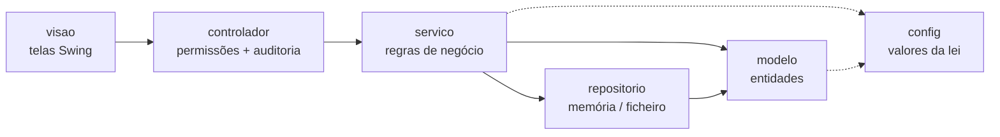

# Arquitectura

## Camadas (MVC com serviços)



| Camada | Responsabilidade | Regra de ouro |
|---|---|---|
| **visao** | Desenhar telas, ler formulários, mostrar resultados | Só conhece os controladores (`app.funcionarios`, ...), nunca serviços nem repositórios |
| **controlador** | Verificar `Sessao.exigir(Permissao)`, filtrar dados pelo perfil, registar auditoria | Sem regras de negócio |
| **servico** | Validar, aplicar regras (férias, folha, integridade), pesquisar | Sem Swing e sem saber quem está autenticado |
| **repositorio** | Guardar e ler entidades (`Repositorio<T>`) | Pode trocar-se por JDBC sem mexer no resto |
| **modelo** | Entidades e cálculos de salário (`Pagavel`) | Sem entrada/saída |

`Aplicacao` é a raiz de composição: cria repositórios → serviços → controladores e semeia os dados de exemplo.

### Exemplo de fluxo: "Admitir funcionário"
1. `FuncionariosFrame.gravar()` lê o formulário e cria um `DadosFuncionario`; chama `Ui.tentar(...)`.
2. `FuncionarioControlador.admitir()` → `sessao.exigir(FUNCIONARIOS_EDITAR)` (senão `AcessoNegadoException`).
3. `FuncionarioServico.admitir()` normaliza, valida **tudo de uma vez** (`ValidacaoException` com a lista de erros), grava no repositório.
4. `RepositorioFicheiro` grava em disco (temporário + renomear); se falhar, desfaz e lança `PersistenciaException`.
5. O controlador regista `FUNCIONARIO_ADMITIDO id=N` na auditoria. A tela recarrega a tabela.
6. Qualquer excepção volta a `Ui.tentar`, que mostra o aviso certo (ou regista o erro técnico).

## Aspecto visual
`visao/Tema` concentra o "look" da aplicação: paleta de cores, tipo de letra, botões arredondados (primário/perigo/secundário),
tabelas com linhas alternadas e cabeçalho azul, cabeçalho de cada tela (`Tema.banner`) e os cartões do menu.
`Navegador` aplica o tema a cada janela ao criá-la (`Tema.estilizar`), por isso as telas não repetem estilos.
Para mudar cores ou fontes de toda a aplicação, basta alterar as constantes em `Tema`. Um componente que deve ficar
de fora leva `putClientProperty("tema.ignorar", true)`. As telas são escritas em código (não usam o desenhador `.form` do NetBeans).

## Modelo de dados
`Pessoa` → `Funcionario` (abstracta, implementa `Pagavel`) → `FuncionarioEfetivo` → `Gestor`;
`FuncionarioContratado`; `Estagiario`. Cada tipo calcula o seu bruto (polimorfismo); INSS, IRPS e líquido
vêm de `Pagavel` com os valores de `ParametrosLegais`. `Ferias` guarda o ano de referência e os dias de gozo
(já sem feriados). `Utilizador` guarda só sal + hash.

## Persistência
- Ficheiros em `dados/`: `funcionarios.dat`, `departamentos.dat`, `ferias.dat`, `utilizadores.dat` (serialização Java)
  e `definicoes.properties` (texto).
- Gravação **atómica** (ficheiro temporário + renomear): uma falha a meio nunca deixa um ficheiro meio escrito.
- Leitura com **filtro de desserialização** (só classes `rh.*` e tipos básicos do JDK).
- Não há migração de versões: ao alterar campos de uma entidade, mantenha o `serialVersionUID` (campos novos ficam a `null`).
- Para JDBC/SQLite basta implementar `Repositorio<T>`.

## Segurança
- Palavras-passe: PBKDF2-HMAC-SHA256, 120 000 iterações, sal aleatório por conta; comparação em tempo constante.
- Mensagem igual para "utilizador inexistente" e "password errada"; bloqueio após 5 falhas; mudança obrigatória no 1.º acesso.
- Autorização nos controladores + filtragem por linha (um funcionário só vê as suas férias e o seu recibo);
  ninguém decide o seu próprio pedido de férias; o último administrador não pode ser desactivado.
- `auditoria.0.log`: quem fez o quê (login, admissões, exportações...), sem palavras-passe, BI nem salários.
- CSV exportado neutraliza injecção de fórmulas.
- **Não protegido:** os ficheiros em `dados/` não estão cifrados — proteja a pasta (permissões do sistema, cópia de segurança cifrada).

## Excepções
```
RuntimeException
└── RhException                    mensagem já amigável
    ├── ValidacaoException         dados inválidos (lista de erros)
    ├── RegraNegocioException      uma regra impede a operação
    ├── RecursoNaoEncontradoException
    ├── AcessoNegadoException
    ├── AutenticacaoException
    └── PersistenciaException      falha de leitura/gravação (registada em rh.0.log)
```
Nas telas, `Ui.tentar()` é o único sítio que apanha excepções. Erros inesperados (bugs) são registados com
stack trace em `rh.0.log` e o utilizador vê uma mensagem simples; `Main` tem ainda um handler global.

## Como estender
- **Nova regra legal:** alterar `config/ParametrosLegais` (valores) ou o serviço respectivo + um teste em `TestesRh`.
- **Novo sector / salário mínimo:** acrescentar em `config/SectorActividade`.
- **Nova tela:** classe que estende `TelaBase`, entrada em `Navegador.Tela`, botão em `MenuPrincipal`, permissão em `Permissao`/`Perfil`.
- **Nova base de dados:** implementar `Repositorio<T>` e trocar em `Aplicacao`.
