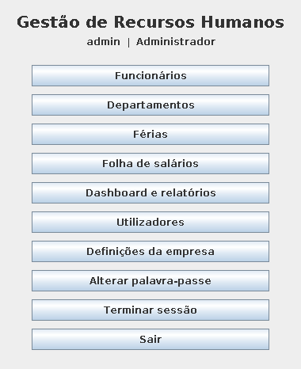
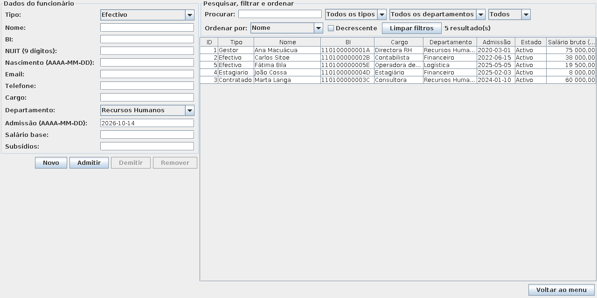
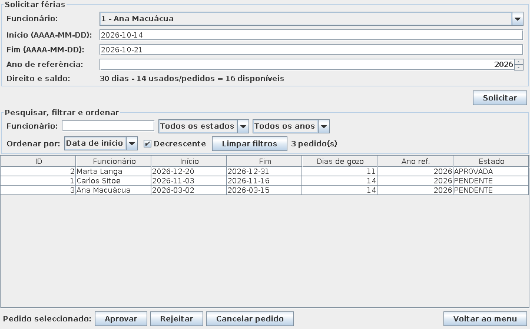
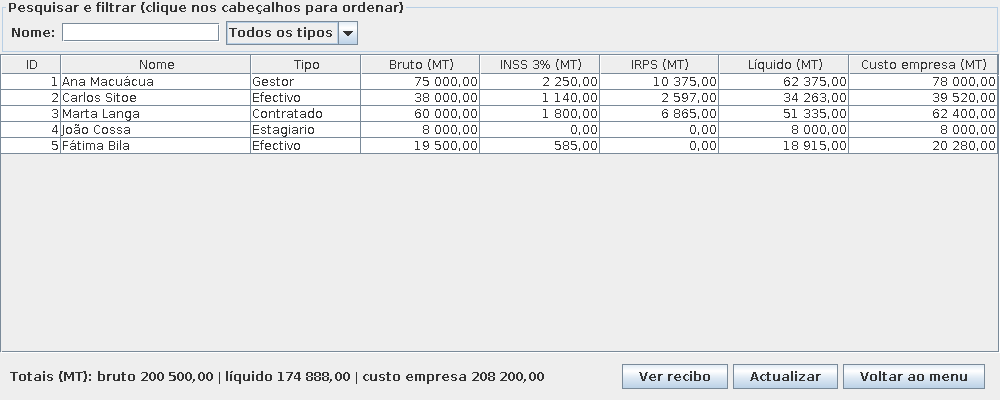
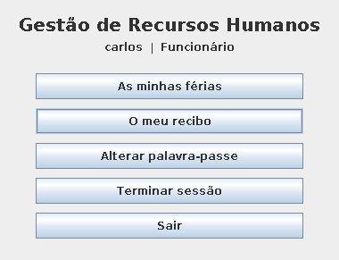
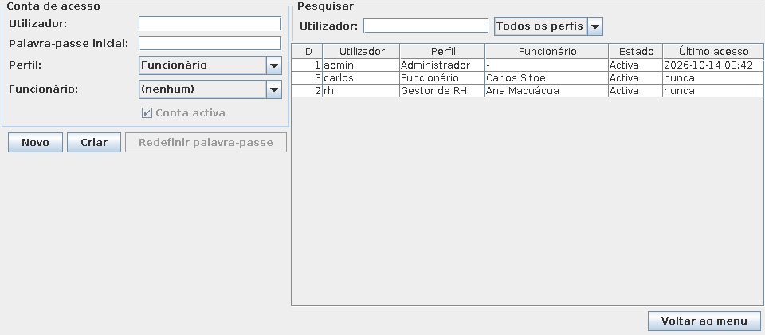

# Manual do utilizador

## 1. Entrar
Introduza utilizador e palavra-passe. No **primeiro acesso** (ou depois de o administrador redefinir a palavra-passe)
o sistema obriga a escolher uma nova: mínimo 8 caracteres, com letras e números. Após **5 tentativas falhadas** a conta
bloqueia; o administrador desbloqueia-a em *Utilizadores > Redefinir palavra-passe*.

O menu mostra apenas o que o seu perfil permite.

## 2. Administrador — preparar a empresa
1. **Definições da empresa:** nome e *sector de actividade*. O sector define o salário mínimo que o sistema exige ao admitir.
2. **Departamentos:** crie os departamentos.
3. **Funcionários:** admita as pessoas (ver 3).
4. **Utilizadores:** crie contas. Um *Funcionário* tem de ser associado a um funcionário; cada funcionário só pode ter uma conta.

## 3. Gestor de RH
### Funcionários

- **Admitir:** preencha o formulário e *Admitir*. Todos os erros aparecem de uma vez. Regras: nome; BI (12 dígitos + 1 letra);
  NUIT (9 dígitos); telefone moçambicano; idade mínima 18 anos; salário base ≥ mínimo do sector.
- **Editar:** clique numa linha, altere e *Guardar*. O tipo não se altera depois de admitido.
- **Demitir** deixa o funcionário inactivo e **mantém o histórico**; *Reactivar* reverte. Remover definitivamente só o administrador,
  e só se não houver pedidos de férias.
- **Procurar:** escreva nome, BI, NUIT, cargo ou email (sem acentos; várias palavras). Filtre por tipo, departamento e estado;
  ordene pela caixa *Ordenar por* ou clicando no cabeçalho das colunas.

### Férias

- Escolha funcionário, datas (AAAA-MM-DD) e **ano de referência** (o do início das férias ou o anterior). O ecrã mostra o saldo.
- Contam-se **dias de calendário**; os **feriados nacionais dentro do período não contam** (20–31 Dez = 11 dias).
- Direito: 12 dias no 1.º ano de trabalho, 30 nos seguintes. Cada período tem de ter pelo menos 6 dias (salvo o último saldo).
- *Aprovar/Rejeitar/Cancelar pedido* actuam sobre a linha seleccionada. Não pode decidir os seus próprios pedidos.

### Folha de salários e recibos

Mostra bruto, INSS (3%), IRPS, líquido e o custo para a empresa de cada funcionário activo. **Ver recibo** mostra o recibo do mês
actual e permite guardá-lo em `.txt`.

### Dashboard e relatórios

Indicadores, gráficos, alertas (férias por decidir, salários abaixo do mínimo, fichas incompletas, contas bloqueadas) e
**exportação para Excel (CSV)** da folha, dos funcionários e das férias. Abra no Excel; os dados pessoais exportados são da sua responsabilidade.

## 4. Funcionário

- **As minhas férias:** pedir férias para si, ver o saldo e cancelar pedidos pendentes.
- **O meu recibo:** ver e guardar o seu recibo de vencimento.
- **Alterar palavra-passe** sempre que quiser.

## 5. Utilizadores (administrador)

Criar contas, mudar perfil, activar/desactivar e **redefinir palavra-passe** (gera uma temporária que o utilizador tem de mudar).

## 6. Cópias de segurança e problemas
- Copie regularmente a pasta `dados/`. Para restaurar, feche a aplicação e substitua a pasta.
- Mensagem *"ficheiro de dados danificado"*: restaure a última cópia de segurança.
- Erros técnicos ficam em `dados/rh.0.log`; o histórico de acções em `dados/auditoria.0.log`.
